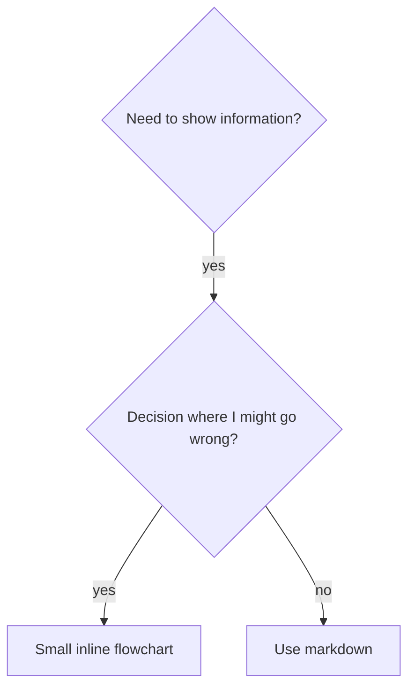

# Flowcharts in Skills

Part of superpowers:writing-skills.

## Flowchart Usage

**Use flowcharts ONLY for:**
- Non-obvious decision points
- Process loops where you might stop too early
- "When to use A vs B" decisions

**Never use flowcharts for:**
- Reference material → Tables, lists
- Code examples → Markdown blocks
- Linear instructions → Numbered lists
- Labels without semantic meaning (step1, helper2)

See `mermaid-conventions.mmd` in this directory for mermaid style rules.
